Angular is a powerful, open-source web application framework developed and maintained by Google. It's designed to build dynamic, scalable, and maintainable single-page applications (SPAs) and progressive web apps (PWAs).

## 🎯 Angular in Simple Terms

Think of Angular as a **complete toolkit** for building modern web applications. Just like a carpenter has a toolbox with different tools for different tasks, Angular provides you with everything you need to build web applications:

- **Components** - The building blocks of your app
- **Services** - For handling data and business logic
- **Router** - For navigation between pages
- **Forms** - For user input and validation
- **HTTP Client** - For communicating with servers
- **Testing Tools** - For ensuring your app works correctly

## 🌟 Why Choose Angular?

### 1. **Complete Framework**
Unlike libraries that focus on one aspect, Angular is a full framework that provides:
- Component architecture
- Dependency injection
- Routing system
- Form handling
- HTTP client
- Testing utilities
- Build tools

### 2. **TypeScript by Default**
Angular is built with TypeScript, which provides:
- Static type checking
- Better IDE support
- Improved code quality
- Enhanced refactoring capabilities
- Better documentation through types

### 3. **Enterprise-Ready**
Angular is designed for large-scale applications:
- Modular architecture
- Consistent code structure
- Powerful CLI tools
- Comprehensive testing support
- Long-term support (LTS) versions

### 4. **Strong Ecosystem**
- **Angular Material** - UI component library
- **Angular CDK** - Component development kit
- **Angular Universal** - Server-side rendering
- **Ionic** - Mobile app development
- **NativeScript** - Native mobile apps

## 🏗️ Angular Architecture Overview

<!-- Show svg image from public folder -->

### Core Building Blocks

1. **Components** - Control parts of the screen (views)
2. **Services** - Provide functionality that isn't directly related to views
3. **Modules** - Organize the application into cohesive blocks
4. **Templates** - Define the component's view with HTML
5. **Directives** - Add behavior to elements in templates
6. **Pipes** - Transform displayed data

## 🆚 Angular vs Other Frameworks

### Angular vs React

| Feature | Angular | React |
|---------|---------|-------|
| **Type** | Full Framework | Library |
| **Language** | TypeScript (default) | JavaScript (TypeScript optional) |
| **Learning Curve** | Steeper | Gentler |
| **Architecture** | Opinionated | Flexible |
| **Data Binding** | Two-way | One-way (default) |
| **Mobile** | Ionic, NativeScript | React Native |
| **Best For** | Enterprise apps | Flexible projects |

### Angular vs Vue.js

| Feature | Angular | Vue.js |
|---------|---------|--------|
| **Complexity** | More complex | Simpler |
| **Performance** | Excellent | Excellent |
| **Ecosystem** | Comprehensive | Growing |
| **Corporate Support** | Google | Independent |
| **TypeScript** | Built-in | Good support |
| **Best For** | Large applications | Quick prototypes |

## 📈 Angular Evolution

### Version History
- **AngularJS (1.x)** - The original (2010-2021)
- **Angular 2** - Complete rewrite (2016)
- **Angular 4-16** - Regular updates every 6 months
- **Angular 17** - New brand, control flow, SSR improvements
- **Angular 18** - Material 3, control flow stable, experimental esbuild
- **Angular 19** - Linked signals, incremental hydration, @let syntax
- **Angular 20** - Zoneless change detection stable

**Angular Can I Use Explorer:**
https://www.dolmen.tools/en/angular/caniuse/explorer

### Latest Features (Angular 18-20)
- **Signals** - New reactivity model
- **Standalone Components** - Simplified architecture
- **Control Flow** - New @if, @for, @switch syntax
- **Zoneless Change Detection** - Better performance
- **Incremental Hydration** - Faster SSR
- **Material 3** - Latest design system

## 🎯 When to Use Angular

### ✅ Perfect for:
- **Large-scale enterprise applications**
- **Complex business logic**
- **Long-term projects** (5+ years)
- **Teams that prefer structure**
- **TypeScript-first development**
- **Applications requiring extensive testing**

### ❌ Consider alternatives for:
- **Simple websites** (use vanilla HTML/CSS/JS)
- **Quick prototypes** (Vue.js might be faster)
- **Small teams** preferring flexibility (React)
- **Projects with tight deadlines** and simple requirements

## 🏢 Who Uses Angular?

### Major Companies
- **Google** - Gmail, Google Cloud Console
- **Microsoft** - Office 365, Xbox
- **Samsung** - SmartThings
- **Deutsche Bank** - Banking applications
- **Nike** - E-commerce platform
- **Upwork** - Freelancing platform
- **PayPal** - Payment processing

### Industries
- **Banking & Finance** - Complex business rules
- **Healthcare** - Regulatory compliance
- **E-commerce** - Large product catalogs
- **Enterprise Software** - Internal tools
- **Government** - Public services

## 🚀 What You'll Build

Throughout this guide, you'll create:

### 🏪 **E-commerce Application**
- Product catalog with search
- Shopping cart with signals
- User authentication
- Payment integration
- Admin dashboard

### 💬 **Real-time Chat App**
- WebSocket integration
- User presence
- File sharing
- Message history

### 📊 **Analytics Dashboard**
- Data visualization
- Real-time updates
- Interactive charts
- Export functionality

### Typical Development Process
1. **Plan** - Define requirements and architecture
2. **Generate** - Use Angular CLI to create components/services
3. **Develop** - Write TypeScript code and templates
4. **Test** - Unit tests, integration tests, e2e tests
5. **Build** - Compile and optimize for production
6. **Deploy** - Deploy to hosting platform
7. **Monitor** - Track performance and errors

## 🎓 Learning Prerequisites

### Required Knowledge
- **HTML** - Structure and semantics
- **CSS** - Styling and layouts
- **JavaScript** - ES6+ features, promises, async/await
- **TypeScript** - Basic types and interfaces (we'll cover this)

### Helpful Experience
- **Git** - Version control
- **Node.js** - JavaScript runtime
- **Command line** - Basic terminal commands
- **Web APIs** - Fetch, localStorage, etc.

## 🎯 Learning Outcomes

After completing this section, you'll understand:
- [ ] What Angular is and its core philosophy
- [ ] Why Angular is chosen for enterprise applications
- [ ] How Angular compares to other frameworks
- [ ] The evolution of Angular and latest features
- [ ] When to use Angular vs alternatives
- [ ] The typical Angular development workflow

## 🚀 Ready to Start?

Now that you understand what Angular is, let's dive into its architecture and start building!

**Next Steps:**
1. **[Angular Architecture](/beginner/architecture/)** - Understand how Angular works
2. **[Your First App](/beginner/first-app/)** - Build your first Angular application

---

**Fun Fact**: Angular powers over 1.5 million websites worldwide and is one of the most popular frameworks for enterprise development! 🌟
